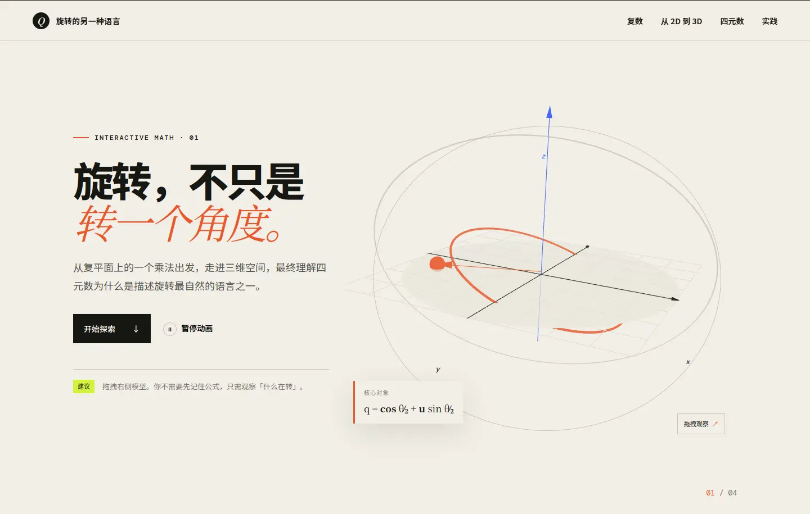

# 旋转的另一种语言 · Quaternion

一个使用 Three.js 构建的交互式中文教程，从复数在二维平面中的旋转出发，逐步建立对三维旋转、万向节死锁和四元数的直觉。



## 教程内容

页面按照一条连续的学习路径组织：

1. **复数与二维旋转**：拖动角度滑块，观察乘以单位复数后向量的变化。
2. **从二维到三维**：理解为什么三维旋转需要“旋转轴 + 旋转角”。
3. **欧拉角的局限**：切换旋转模式，观察万向节死锁与轴层级关系。
4. **四元数直觉**：拆解标量部、向量部、半角和夹心乘法。
5. **Three.js 实践**：用 `Quaternion.setFromAxisAngle()` 将轴角旋转应用到物体。

## 交互功能

- 拖拽 Three.js 场景改变观察视角
- 调整复平面旋转角度并实时更新公式
- 在欧拉角和四元数两种旋转模式之间切换
- 暂停或继续全部场景动画
- 一键复制 Three.js 示例代码
- 阅读进度指示与章节导航
- 桌面端和移动端响应式布局
- 尊重系统的“减少动态效果”设置

## 技术栈

- [Three.js](https://threejs.org/)：三维场景与数学可视化
- [Vite](https://vite.dev/)：开发服务器与生产构建
- 原生 JavaScript、HTML 与 CSS

## 本地运行

需要 Node.js 20.19 或更高版本。

```bash
npm install
npm run dev
```

随后打开终端显示的本地地址，通常为 `http://localhost:5173`。

## 生产构建

```bash
npm run build
npm run preview
```

构建产物会生成在 `dist/` 目录中。

## 项目结构

```text
Quaternion/
├── docs/
│   └── preview.webp     # README 预览图
├── src/
│   ├── main.js          # 页面内容、交互状态与 Three.js 场景
│   └── style.css        # 视觉系统与响应式布局
├── index.html
├── package.json
└── README.md
```

## 常用命令

| 命令 | 作用 |
| --- | --- |
| `npm run dev` | 启动本地开发服务器 |
| `npm run build` | 生成生产构建 |
| `npm run preview` | 本地预览生产构建 |
